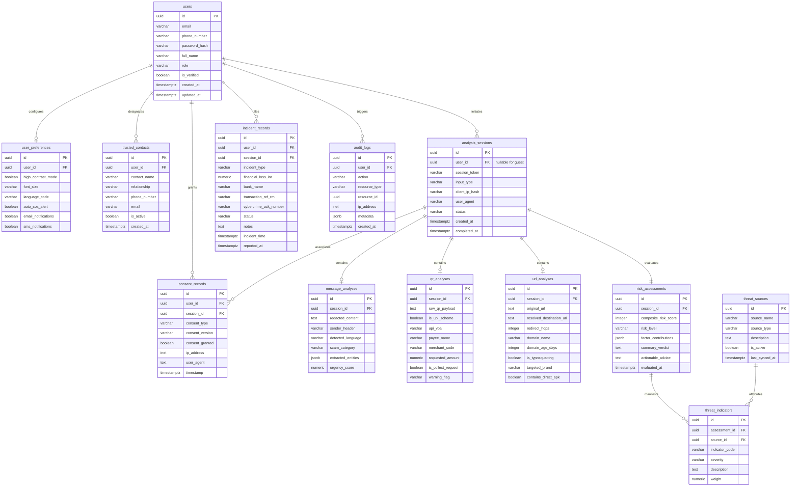

# Database Architecture & Schema Specification
## Project: FraudShield — AI-Powered Digital Payment Fraud Prevention Platform
**Document Version:** 1.0.0  
**Status:** Approved for Implementation Phase  
**Database Engine:** PostgreSQL 16.x (Supabase Managed)  

---

## 1. Schema Overview & Relational Design

The FraudShield database architecture is designed with **3rd Normal Form (3NF)** normalization to guarantee data integrity, eliminate data redundancy, and ensure high query throughput. The schema is organized around core operational entities:
1. **Identity & User Management:** `users`, `user_preferences`, `trusted_contacts`
2. **Analysis Operations:** `analysis_sessions`, `message_analyses`, `qr_analyses`, `url_analyses`
3. **Risk & Threat Intelligence:** `risk_assessments`, `threat_indicators`, `threat_sources`
4. **Incidents & Legal Compliance:** `incident_records`, `consent_records`, `audit_logs`

All tables use `UUIDv4` primary keys to prevent enumeration attacks and facilitate seamless future horizontal sharding.

---

## 2. Entity-Relationship Diagram (ERD)



---

## 3. Complete PostgreSQL Table Definitions (DDL)

```sql
-- Enable necessary extensions
CREATE EXTENSION IF NOT EXISTS "uuid-ossp";
CREATE EXTENSION IF NOT EXISTS "pgcrypto";

-- Custom Enums
CREATE TYPE user_role AS ENUM ('USER', 'VERIFIED_USER', 'FAMILY_GUARDIAN', 'ADMIN');
CREATE TYPE input_type_enum AS ENUM ('TEXT_MESSAGE', 'QR_IMAGE', 'PAYMENT_SCREENSHOT', 'URL');
CREATE TYPE session_status_enum AS ENUM ('PENDING', 'PROCESSING', 'COMPLETED', 'FAILED');
CREATE TYPE risk_level_enum AS ENUM ('LOW', 'MEDIUM', 'HIGH', 'CRITICAL');
CREATE TYPE severity_enum AS ENUM ('INFO', 'LOW', 'MEDIUM', 'HIGH', 'CRITICAL');
CREATE TYPE incident_status_enum AS ENUM ('DRAFT', 'SUBMITTED_TO_BANK', 'REPORTED_1930', 'RESOLVED', 'CLOSED');

-- ============================================================================
-- 1. USERS TABLE
-- ============================================================================
CREATE TABLE users (
    id UUID PRIMARY KEY DEFAULT uuid_generate_v4(),
    email VARCHAR(255) NOT NULL UNIQUE,
    phone_number VARCHAR(20) UNIQUE,
    password_hash VARCHAR(255) NOT NULL,
    full_name VARCHAR(150) NOT NULL,
    role user_role NOT NULL DEFAULT 'USER',
    is_verified BOOLEAN NOT NULL DEFAULT FALSE,
    refresh_token_hash VARCHAR(255),
    failed_login_attempts INTEGER NOT NULL DEFAULT 0,
    lockout_until TIMESTAMPTZ,
    last_login_at TIMESTAMPTZ,
    created_at TIMESTAMPTZ NOT NULL DEFAULT CURRENT_TIMESTAMP,
    updated_at TIMESTAMPTZ NOT NULL DEFAULT CURRENT_TIMESTAMP,
    deleted_at TIMESTAMPTZ
);

-- Constraint for Indian phone number syntax if present
ALTER TABLE users ADD CONSTRAINT check_phone_format 
    CHECK (phone_number IS NULL OR phone_number ~ '^\+91[6-9][0-9]{9}$');

-- ============================================================================
-- 2. USER PREFERENCES TABLE
-- ============================================================================
CREATE TABLE user_preferences (
    id UUID PRIMARY KEY DEFAULT uuid_generate_v4(),
    user_id UUID NOT NULL UNIQUE REFERENCES users(id) ON DELETE CASCADE,
    high_contrast_mode BOOLEAN NOT NULL DEFAULT FALSE,
    font_size VARCHAR(10) NOT NULL DEFAULT 'MEDIUM' CHECK (font_size IN ('STANDARD', 'MEDIUM', 'LARGE', 'EXTRA_LARGE')),
    language_code VARCHAR(10) NOT NULL DEFAULT 'en' CHECK (language_code IN ('en', 'hi', 'ta', 'te', 'mr', 'bn')),
    auto_sos_alert BOOLEAN NOT NULL DEFAULT TRUE,
    email_notifications BOOLEAN NOT NULL DEFAULT TRUE,
    sms_notifications BOOLEAN NOT NULL DEFAULT TRUE,
    updated_at TIMESTAMPTZ NOT NULL DEFAULT CURRENT_TIMESTAMP
);

-- ============================================================================
-- 3. TRUSTED CONTACTS TABLE
-- ============================================================================
CREATE TABLE trusted_contacts (
    id UUID PRIMARY KEY DEFAULT uuid_generate_v4(),
    user_id UUID NOT NULL REFERENCES users(id) ON DELETE CASCADE,
    contact_name VARCHAR(150) NOT NULL,
    relationship VARCHAR(50) NOT NULL,
    phone_number VARCHAR(20) NOT NULL,
    email VARCHAR(255),
    is_active BOOLEAN NOT NULL DEFAULT TRUE,
    created_at TIMESTAMPTZ NOT NULL DEFAULT CURRENT_TIMESTAMP,
    updated_at TIMESTAMPTZ NOT NULL DEFAULT CURRENT_TIMESTAMP,
    CONSTRAINT check_contact_phone CHECK (phone_number ~ '^\+91[6-9][0-9]{9}$')
);

-- ============================================================================
-- 4. ANALYSIS SESSIONS TABLE
-- ============================================================================
CREATE TABLE analysis_sessions (
    id UUID PRIMARY KEY DEFAULT uuid_generate_v4(),
    user_id UUID REFERENCES users(id) ON DELETE SET NULL, -- Guest sessions have NULL user_id
    session_token VARCHAR(64) NOT NULL UNIQUE,
    input_type input_type_enum NOT NULL,
    client_ip_hash VARCHAR(64) NOT NULL, -- SHA-256 hashed IP for rate limiting and privacy
    user_agent TEXT,
    status session_status_enum NOT NULL DEFAULT 'PENDING',
    created_at TIMESTAMPTZ NOT NULL DEFAULT CURRENT_TIMESTAMP,
    completed_at TIMESTAMPTZ
);

-- ============================================================================
-- 5. MESSAGE ANALYSES TABLE
-- ============================================================================
CREATE TABLE message_analyses (
    id UUID PRIMARY KEY DEFAULT uuid_generate_v4(),
    session_id UUID NOT NULL UNIQUE REFERENCES analysis_sessions(id) ON DELETE CASCADE,
    redacted_content TEXT NOT NULL,
    sender_header VARCHAR(50),
    detected_language VARCHAR(10) DEFAULT 'en',
    scam_category VARCHAR(100),
    extracted_entities JSONB NOT NULL DEFAULT '{}'::jsonb,
    urgency_score NUMERIC(5,2) NOT NULL DEFAULT 0.0 CHECK (urgency_score >= 0 AND urgency_score <= 100),
    created_at TIMESTAMPTZ NOT NULL DEFAULT CURRENT_TIMESTAMP
);

-- ============================================================================
-- 6. QR ANALYSES TABLE
-- ============================================================================
CREATE TABLE qr_analyses (
    id UUID PRIMARY KEY DEFAULT uuid_generate_v4(),
    session_id UUID NOT NULL UNIQUE REFERENCES analysis_sessions(id) ON DELETE CASCADE,
    raw_qr_payload TEXT NOT NULL,
    is_upi_scheme BOOLEAN NOT NULL DEFAULT FALSE,
    upi_vpa VARCHAR(255),
    payee_name VARCHAR(255),
    merchant_code VARCHAR(20),
    requested_amount NUMERIC(12,2),
    is_collect_request BOOLEAN NOT NULL DEFAULT FALSE,
    warning_flag VARCHAR(255),
    created_at TIMESTAMPTZ NOT NULL DEFAULT CURRENT_TIMESTAMP
);

-- ============================================================================
-- 7. URL ANALYSES TABLE
-- ============================================================================
CREATE TABLE url_analyses (
    id UUID PRIMARY KEY DEFAULT uuid_generate_v4(),
    session_id UUID NOT NULL UNIQUE REFERENCES analysis_sessions(id) ON DELETE CASCADE,
    original_url TEXT NOT NULL,
    resolved_destination_url TEXT NOT NULL,
    redirect_hops INTEGER NOT NULL DEFAULT 0,
    domain_name VARCHAR(255) NOT NULL,
    domain_age_days INTEGER,
    is_typosquatting BOOLEAN NOT NULL DEFAULT FALSE,
    targeted_brand VARCHAR(100),
    contains_direct_apk BOOLEAN NOT NULL DEFAULT FALSE,
    created_at TIMESTAMPTZ NOT NULL DEFAULT CURRENT_TIMESTAMP
);

-- ============================================================================
-- 8. RISK ASSESSMENTS TABLE
-- ============================================================================
CREATE TABLE risk_assessments (
    id UUID PRIMARY KEY DEFAULT uuid_generate_v4(),
    session_id UUID NOT NULL UNIQUE REFERENCES analysis_sessions(id) ON DELETE CASCADE,
    composite_risk_score INTEGER NOT NULL CHECK (composite_risk_score >= 0 AND composite_risk_score <= 100),
    risk_level risk_level_enum NOT NULL,
    factor_contributions JSONB NOT NULL DEFAULT '{}'::jsonb,
    summary_verdict TEXT NOT NULL,
    actionable_advice TEXT NOT NULL,
    evaluated_at TIMESTAMPTZ NOT NULL DEFAULT CURRENT_TIMESTAMP
);

-- ============================================================================
-- 9. THREAT SOURCES TABLE
-- ============================================================================
CREATE TABLE threat_sources (
    id UUID PRIMARY KEY DEFAULT uuid_generate_v4(),
    source_name VARCHAR(100) NOT NULL UNIQUE,
    source_type VARCHAR(50) NOT NULL,
    description TEXT,
    is_active BOOLEAN NOT NULL DEFAULT TRUE,
    last_synced_at TIMESTAMPTZ
);

-- ============================================================================
-- 10. THREAT INDICATORS TABLE
-- ============================================================================
CREATE TABLE threat_indicators (
    id UUID PRIMARY KEY DEFAULT uuid_generate_v4(),
    assessment_id UUID NOT NULL REFERENCES risk_assessments(id) ON DELETE CASCADE,
    source_id UUID REFERENCES threat_sources(id) ON DELETE SET NULL,
    indicator_code VARCHAR(100) NOT NULL,
    severity severity_enum NOT NULL,
    description TEXT NOT NULL,
    weight NUMERIC(5,2) NOT NULL DEFAULT 1.0,
    created_at TIMESTAMPTZ NOT NULL DEFAULT CURRENT_TIMESTAMP
);

-- ============================================================================
-- 11. INCIDENT RECORDS TABLE
-- ============================================================================
CREATE TABLE incident_records (
    id UUID PRIMARY KEY DEFAULT uuid_generate_v4(),
    user_id UUID NOT NULL REFERENCES users(id) ON DELETE CASCADE,
    session_id UUID REFERENCES analysis_sessions(id) ON DELETE SET NULL,
    incident_type VARCHAR(100) NOT NULL,
    financial_loss_inr NUMERIC(12,2) DEFAULT 0.00,
    bank_name VARCHAR(100),
    transaction_ref_rrn VARCHAR(50),
    cybercrime_ack_number VARCHAR(100),
    status incident_status_enum NOT NULL DEFAULT 'DRAFT',
    notes TEXT,
    incident_time TIMESTAMPTZ NOT NULL,
    reported_at TIMESTAMPTZ NOT NULL DEFAULT CURRENT_TIMESTAMP,
    updated_at TIMESTAMPTZ NOT NULL DEFAULT CURRENT_TIMESTAMP
);

-- ============================================================================
-- 12. CONSENT RECORDS TABLE (DPDP Act 2023 Compliance)
-- ============================================================================
CREATE TABLE consent_records (
    id UUID PRIMARY KEY DEFAULT uuid_generate_v4(),
    user_id UUID REFERENCES users(id) ON DELETE SET NULL,
    session_id UUID REFERENCES analysis_sessions(id) ON DELETE CASCADE,
    consent_type VARCHAR(50) NOT NULL, -- e.g., 'DATA_PROCESSING', 'OCR_ANALYSIS'
    consent_version VARCHAR(20) NOT NULL DEFAULT 'v1.0',
    consent_granted BOOLEAN NOT NULL DEFAULT TRUE,
    ip_address INET,
    user_agent TEXT,
    timestamp TIMESTAMPTZ NOT NULL DEFAULT CURRENT_TIMESTAMP
);

-- ============================================================================
-- 13. AUDIT LOGS TABLE
-- ============================================================================
CREATE TABLE audit_logs (
    id UUID PRIMARY KEY DEFAULT uuid_generate_v4(),
    user_id UUID REFERENCES users(id) ON DELETE SET NULL,
    action VARCHAR(100) NOT NULL,
    resource_type VARCHAR(100) NOT NULL,
    resource_id UUID,
    ip_address INET,
    metadata JSONB DEFAULT '{}'::jsonb,
    created_at TIMESTAMPTZ NOT NULL DEFAULT CURRENT_TIMESTAMP
);
```

---

## 4. Performance Indexes & Optimizations

```sql
-- Indexes for Users
CREATE INDEX idx_users_email ON users(email);
CREATE INDEX idx_users_phone ON users(phone_number);
CREATE INDEX idx_users_role ON users(role);

-- Indexes for Trusted Contacts
CREATE INDEX idx_trusted_contacts_user_id ON trusted_contacts(user_id);
CREATE INDEX idx_trusted_contacts_active ON trusted_contacts(user_id) WHERE is_active = TRUE;

-- Indexes for Analysis Sessions
CREATE INDEX idx_analysis_sessions_user_id ON analysis_sessions(user_id);
CREATE INDEX idx_analysis_sessions_token ON analysis_sessions(session_token);
CREATE INDEX idx_analysis_sessions_created ON analysis_sessions(created_at DESC);
CREATE INDEX idx_analysis_sessions_ip_hash ON analysis_sessions(client_ip_hash);

-- GIN Indexes for JSONB fields
CREATE INDEX idx_message_analyses_entities ON message_analyses USING gin (extracted_entities);
CREATE INDEX idx_risk_assessments_factors ON risk_assessments USING gin (factor_contributions);
CREATE INDEX idx_audit_logs_metadata ON audit_logs USING gin (metadata);

-- Indexes for Fast Risk Lookups
CREATE INDEX idx_risk_assessments_level ON risk_assessments(risk_level);
CREATE INDEX idx_threat_indicators_assessment ON threat_indicators(assessment_id);
CREATE INDEX idx_threat_indicators_code ON threat_indicators(indicator_code);

-- Incident Lookup Indexes
CREATE INDEX idx_incident_records_user_id ON incident_records(user_id);
CREATE INDEX idx_incident_records_status ON incident_records(status);
CREATE INDEX idx_incident_records_time ON incident_records(incident_time DESC);

-- Consent Audit Index
CREATE INDEX idx_consent_records_user ON consent_records(user_id);
CREATE INDEX idx_consent_records_session ON consent_records(session_id);
```

---

## 5. Row-Level Security (RLS) Policies (Supabase)

To guarantee multi-tenant tenant isolation and protect user data:

```sql
-- Enable RLS on user-specific tables
ALTER TABLE users ENABLE ROW LEVEL SECURITY;
ALTER TABLE user_preferences ENABLE ROW LEVEL SECURITY;
ALTER TABLE trusted_contacts ENABLE ROW LEVEL SECURITY;
ALTER TABLE analysis_sessions ENABLE ROW LEVEL SECURITY;
ALTER TABLE incident_records ENABLE ROW LEVEL SECURITY;

-- 1. Users can only read and update their own profile
CREATE POLICY user_read_own ON users
    FOR SELECT USING (auth.uid() = id);

CREATE POLICY user_update_own ON users
    FOR UPDATE USING (auth.uid() = id);

-- 2. User Preferences policy
CREATE POLICY pref_manage_own ON user_preferences
    FOR ALL USING (auth.uid() = user_id);

-- 3. Trusted Contacts policy
CREATE POLICY contacts_manage_own ON trusted_contacts
    FOR ALL USING (auth.uid() = user_id);

-- 4. Analysis Sessions: Users see their own; Guests cannot view other sessions
CREATE POLICY sessions_read_own ON analysis_sessions
    FOR SELECT USING (auth.uid() = user_id OR user_id IS NULL);

-- 5. Incident Records policy
CREATE POLICY incidents_manage_own ON incident_records
    FOR ALL USING (auth.uid() = user_id);
```

---

## 6. Migration & Rollback Strategy

We follow an automated, sequential migration pipeline managed via Supabase CLI and Flyway/Node.js migration runner:

1. **Versioned SQL Scripts:** Stored in `/database/migrations/` with standardized nomenclature:  
   `V001__create_users_and_auth.sql`  
   `V002__create_analysis_engine_schema.sql`  
   `V003__create_incident_and_compliance.sql`  
   `V004__apply_indexes_and_rls.sql`
2. **Backward-Compatible Changes:** Expanding schemas (adding nullable columns or defaults) precedes contract modifications. Destructive alterations (dropping columns or renames) require dual-write transition phases.
3. **Rollback Procedures:** Each migration script has a paired `.down.sql` script testing the complete reversible teardown:
   ```sql
   -- Example Rollback for V002
   DROP TABLE IF EXISTS threat_indicators CASCADE;
   DROP TABLE IF EXISTS risk_assessments CASCADE;
   DROP TABLE IF EXISTS url_analyses CASCADE;
   DROP TABLE IF EXISTS qr_analyses CASCADE;
   DROP TABLE IF EXISTS message_analyses CASCADE;
   DROP TABLE IF EXISTS analysis_sessions CASCADE;
   ```
4. **Pre-Deployment CI Verification:** Every PR runs migrations against an ephemeral test PostgreSQL database container before merging into `main`.

---

## 7. Data Retention & Purging Lifecycle (DPDP Act Compliance)

To satisfy data minimization requirements under India's Digital Personal Data Protection Act:

| Table / Data Asset | Retention Period | Purge / Archival Action | Implementation Mechanism |
|---|---|---|---|
| **Temporary Upload Images** | 24 Hours | Hard delete from ephemeral storage | Automated cron job executing `DELETE FROM storage WHERE created_at < NOW() - INTERVAL '24 hours'` |
| **Guest Analysis Sessions** | 7 Days | Full purge of unauthenticated records | Scheduled worker running `DELETE FROM analysis_sessions WHERE user_id IS NULL AND created_at < NOW() - INTERVAL '7 days'` |
| **Authenticated Analysis History** | 2 Years (or upon user account deletion) | Anonymization of raw text, keeping aggregate risk stats | Column sanitization: `UPDATE message_analyses SET redacted_content = '[PURGED]' WHERE created_at < NOW() - INTERVAL '2 years'` |
| **Incident Reports** | 7 Years | Cold storage archival (financial record compliance) | Dumped to encrypted S3 Glacier bucket for banking and legal subpoena compliance |
| **Audit Logs** | 3 Years | Read-only append, partitioned quarterly | PostgreSQL table partitioning by `created_at` range |
| **User Right to be Forgotten** | Instant upon request | Complete cascade deletion | Foreign key `ON DELETE CASCADE` triggers across all linked tables |

---

## 8. Summary & Database Readiness

The defined PostgreSQL schema enforces strict data types, relational constraints, and security isolation. The model accommodates high-speed writes during batch threat scans while maintaining compliance with Indian financial data privacy regulations.
