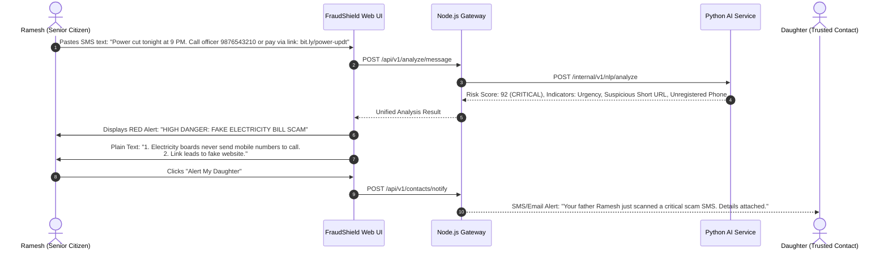
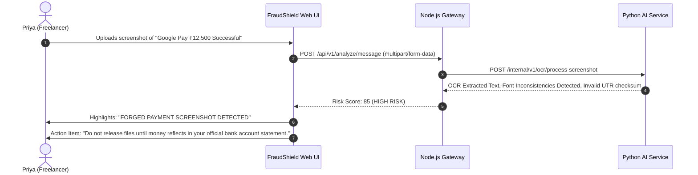
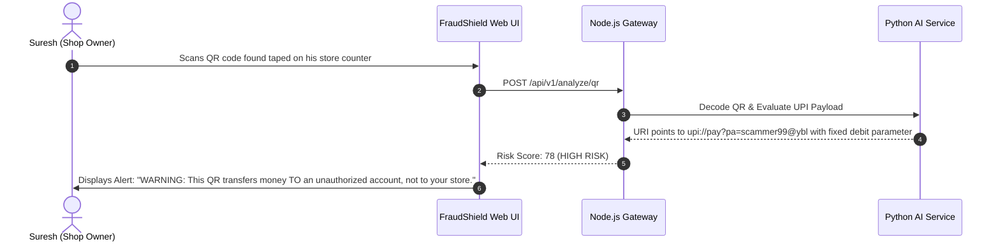

# Product Requirements Document (PRD)
## Project: FraudShield — AI-Powered Digital Payment Fraud Prevention Platform for India
**Document Version:** 1.0.0  
**Status:** Approved for Architecture Phase  
**Target Market:** India (Evolving to Pan-South Asia)  
**Classification:** Confidential / Internal Engineering & Product  

---

## 1. Executive Summary & Problem Statement

### 1.1 The Context of Digital Payments in India
India's Unified Payments Interface (UPI) processes in excess of **14 billion transactions monthly** with a transaction value exceeding ₹20 lakh crore. The rapid democratization of digital payments via apps such as Google Pay, PhonePe, Paytm, and BHIM has brought financial inclusion to hundreds of millions of first-time digital users across Tier-1, Tier-2, Tier-3 cities, and rural areas.

However, this hyper-growth has been accompanied by a surge in sophisticated cyber financial crimes:
- **UPI "Collect Request" and "Refund" Frauds:** Scammers send collect/debit requests masquerading as approvals, cashback rewards, or merchant refunds. Victims enter their UPI PIN under the false impression that they are "receiving" money.
- **Deceptive Dynamic & Tampered QR Codes:** Physical sticker swapping at retail counters and malicious digital QR codes embedding hidden debit intents, malicious URL redirects, or modified beneficiary VPA (Virtual Payment Address) parameters.
- **Malicious APKs & Sideloaded Trojans:** Scammers distribute disguised APK files via WhatsApp or SMS (e.g., "ElectricityBillUpdate.apk", "PMKisanBonus.apk", "BankKYCUpdate.apk") that capture SMS OTPs and take over banking sessions.
- **Urgency-Driven Impersonation Phishing:** Fake SMS headers (spoofing banks, electricity boards, credit card providers) threatening immediate power disconnection, account suspension, or SIM deactivation within hours, paired with obfuscated short URLs.
- **Social Engineering Targeting Vulnerable Demographics:** Senior citizens, pensioners, and digital novices frequently fall prey to screen-sharing scams (AnyDesk, TeamViewer QuickSupport) and fake customer care numbers indexed on search engines.

### 1.2 The Problem Statement
Existing cybersecurity solutions in India are reactive and fragmented:
1. **Post-Mortem Nature:** Victims discover fraud **after** debit notifications arrive. Reporting to the National Cyber Crime Reporting Portal (1930 / cybercrime.gov.in) occurs hours or days later, when stolen funds have already been layered across mule accounts and crypto rails.
2. **Technical Complexity:** Security advice is couched in arcane technical jargon that leaves ordinary citizens unable to evaluate risks in real-time.
3. **Siloed Threat Intelligence:** Users lack a singular, trusted pre-transaction utility to check an SMS, inspect a suspicious payment QR code, or verify a dubious URL **before** taking financial action.

### 1.3 Project Vision
**FraudShield** is an AI-powered, pre-transaction fraud prevention and threat intelligence platform designed specifically for the Indian financial ecosystem. It empowers users to analyze suspicious text messages, payment screenshots, QR codes, and URLs within 1.5 seconds, providing an explainable risk score, clear contextual warnings in plain language, and an automated emergency incident response playbook if fraud has already occurred.

---

## 2. Project Objectives & Success Metrics

### 2.1 Core Objectives
1. **Pre-Transaction Prevention:** Intercept and evaluate potential fraud indicators before the user enters a UPI PIN or clicks an unauthorized link.
2. **Explainable AI (XAI):** Eliminate "black box" risk scores. Deliver clear, transparent explanations: *Why is this message suspicious? What specific cues triggered the alert?*
3. **Multi-Format Threat Surface Coverage:** Provide a unified inspection engine for SMS text, WhatsApp messages, payment screenshots, physical/digital QR codes, and web links.
4. **Accessible Indian UX:** Design an intuitive, high-contrast, bilingual-ready interface suitable for senior citizens and non-technical users.
5. **Rapid Incident Containment:** Provide actionable 1-click step-by-step guidance (1930 portal integration, bank freezing templates, SMS drafting, and trusted contact alert broadcast).

### 2.2 Key Performance Indicators (KPIs) & Success Metrics
| Metric Category | Metric | Baseline / Target | Measurement Method |
|---|---|---|---|
| **Detection Performance** | Precision on Known Indian Scams | >= 96.5% | Held-out labeled validation dataset of Indian scam corpus |
| **Detection Performance** | Recall on Critical Phishing/APKs | >= 98.0% | Minimized false negatives for zero financial loss |
| **System Latency** | End-to-End Analysis Response Time | <= 1.5 seconds (p95) | Telemetry on `/api/v1/analyze/*` endpoints |
| **OCR Processing Speed** | Image to Extracted Text & QR Decode | <= 900 ms (p95) | FastAPI ML engine benchmark |
| **User Trust & Comprehension**| Explainability Helpfulness Score | >= 90% positive | User feedback rating on analysis result card |
| **Incident Velocity** | Time to Complete Emergency Freeze Checklist | < 3 minutes | Step completion telemetry on Incident Center |
| **Platform Availability** | System Uptime | 99.9% | Synthetic uptime probes & monitoring |

---

## 3. Target Users & User Personas

### 3.1 Demographic Segmentation
- **Primary:** Individuals across India actively using UPI, mobile banking, and digital wallets.
- **Vulnerable Segment:** Senior citizens, pensioners, and first-time digital users (Tier 2/3/4 towns).
- **Secondary:** Micro-merchants and kirana shop owners accepting daily QR payments.
- **Protective Segment:** Digital-savvy family members ("Family Guardians") who configure safety guards for elderly relatives.

---

### 3.2 User Personas

#### Persona 1: Ramesh Chandra (The Senior Pensioner)
- **Age:** 66
- **Location:** Lucknow, Uttar Pradesh
- **Occupation:** Retired State Government Officer
- **Tech Fluency:** Low to Moderate (Uses WhatsApp for family, PhonePe for electricity bills and milk booth)
- **Pain Point:** Frequently receives SMS alerts stating *"Dear Customer, your SBI YONO account will be blocked today due to pending KYC. Click here to update pan: http://bit.ly/sbi-kyc-updt"*. Cannot distinguish between an official bank communication and a malicious phishing domain. Anxious about losing pension savings.
- **Needs:** Large text, simple language without jargon, clear Green (SAFE) / Amber (CAUTION) / Red (DANGER) indicators, and an immediate button to alert his son in Bengaluru.

#### Persona 2: Priya Sharma (The Freelance Creator / Digital Power User)
- **Age:** 27
- **Location:** Pune, Maharashtra
- **Occupation:** Independent Graphic Designer & Content Creator
- **Tech Fluency:** High (Active on UPI, credit cards, crypto, international remittances)
- **Pain Point:** Sells digital assets and receives suspicious payment screenshots from unknown clients claiming *"I have paid ₹12,500 via Google Pay, here is the confirmation screenshot. Please release the design files."* The screenshot looks authentic at first glance but is forged using fake payment proof generator apps.
- **Needs:** High-precision image OCR verification, UPI Transaction ID (RRN) structural validation, QR code payload deconstruction, and instant URL reputation lookup.

#### Persona 3: Suresh Patel (The Small Merchant / Kirana Store Owner)
- **Age:** 44
- **Location:** Ahmedabad, Gujarat
- **Occupation:** Retail Store Owner
- **Tech Fluency:** Moderate (Uses Paytm Soundbox and BharatPe QR stand)
- **Pain Point:** Scammers display fake payment confirmation screens on their phone without money hitting the account, or swap printed counter QR stickers with malicious ones after hours.
- **Needs:** Fast QR scanner that decodes UPI deep-links (`upi://pay?...`) and validates merchant VPA parameters to ensure payments route to the authorized recipient.

#### Persona 4: Ananya Iyer (The Tech-Savvy Family Guardian)
- **Age:** 32
- **Location:** Bengaluru, Karnataka
- **Occupation:** Lead Product Engineer
- **Tech Fluency:** Very High
- **Pain Point:** Constant worry that her aging parents living in Coimbatore will fall victim to a digital arrest scam or screen-sharing fraud.
- **Needs:** Designation as a "Trusted Contact" in FraudShield to receive instant SMS/WhatsApp webhook alerts whenever her parents trigger a High-Risk or Critical-Risk analysis scan.

---

## 4. User Pain Points & Opportunity Mapping

| Existing User Pain Point | Psychological Trigger | FraudShield Technical Solution |
|---|---|---|
| Inability to tell if an SMS from "VM-SBINB" or "AD-HDFCBK" is authentic | Fear of account freeze / urgency | NLP Header & Content Analyzer with known banking shortcode verification and heuristic urgency scoring. |
| Scammed by fake payment "Refund" QR codes | Greed or confusion regarding UPI debit mechanics | QR Payload Parser checking for `upi://pay` parameters: flags when a transaction is set to debit rather than credit. |
| Sideloading harmful `.apk` files sent via WhatsApp | Authority deception ("Official Electricity Board update") | URL & Link Analyzer identifying direct APK download links, dynamic redirects, and suspicious domain ages. |
| Forged Google Pay / PhonePe transaction screenshots | Social pressure to dispatch goods/services immediately | Deep OCR inspection verifying font inconsistencies, alignment errors, and timestamp/UTR syntax validation. |
| Helplessness during active fraud (Panic mode) | Cognitive overload and ignorance of bank emergency protocols | Automated "Fraud Response Center" generating 1930 portal complaints, bank dispute hotlines, and instant freeze steps. |

---

## 5. Functional Requirements (FR)

### Module 1: Core Analysis Engine & Ingestion (FR-ENG)
- **FR-ENG-01:** Support text input via direct copy-paste (max 5,000 characters) for SMS, WhatsApp messages, and email excerpts.
- **FR-ENG-02:** Support image upload (JPEG, PNG, WebP up to 10 MB) for SMS screenshots, payment receipts, and QR code photos.
- **FR-ENG-03:** Support direct URL input for standalone website and link safety checks.
- **FR-ENG-04:** Provide pre-upload client-side image compression and MIME-type validation.
- **FR-ENG-05:** Implement automatic redaction of user personal identifiable information (PII) such as 16-digit debit card numbers, CVVs, and Aadhaar numbers prior to deep AI processing.

### Module 2: Message & SMS Threat Analyzer (FR-MSG)
- **FR-MSG-01:** Extract sender IDs, telephone numbers, embedded URLs, and monetary amounts from text inputs.
- **FR-MSG-02:** Perform Natural Language Processing (NLP) classification on threat categories:
  - *Electricity/Utility bill disconnection scam*
  - *Bank KYC / PAN update account suspension scam*
  - *Lottery, job offer, and part-time YouTube like/Telegram investment scam*
  - *Sextortion and Digital Arrest impersonation scam*
  - *Courier / Customs package retention scam (FedEx, India Post)*
- **FR-MSG-03:** Evaluate heuristic urgency vectors (e.g., "within 2 hours", "immediate legal action", "account blocked").
- **FR-MSG-04:** Cross-reference sender headers against the TRAI DLT (Distributed Ledger Technology) commercial header registry.

### Module 3: QR Code & UPI Deep-Link Analyzer (FR-QR)
- **FR-QR-01:** Locate and decode QR codes from uploaded images with auto-rotation, skew correction, and contrast normalization.
- **FR-QR-02:** Parse standard UPI URI schemes:
  `upi://pay?pa=<vpa>&pn=<name>&mc=<mcc>&tid=<tid>&tr=<ref>&tn=<note>&am=<amount>&cu=INR`
- **FR-QR-03:** Detect **Collect vs. Pay inversions**: Explicitly warn users that entering a UPI PIN on the scanned QR will result in money deducted from their account, never credited.
- **FR-QR-04:** VPA Reputation Checker: Check recipient VPA handle (e.g., `@okhdfcbank`, `@paytm`) against known scam merchant registries and blacklists.
- **FR-QR-05:** Non-UPI QR Detection: Identify if a QR resolves to an obfuscated web link, shortened URL, or APK download file instead of a valid payment intent.

### Module 4: URL & Domain Safety Inspector (FR-URL)
- **FR-URL-01:** Canonicalize and unshorten URLs (e.g., bit.ly, tinyurl, t.co, is.gd) via server-side safe head inspection without executing malicious payloads.
- **FR-URL-02:** Compute domain similarity (Levenshtein distance) against top 100 Indian banking and e-commerce domains to detect typosquatting (e.g., `onlinesb1.com`, `hdfc-bank-kyc.in`).
- **FR-URL-03:** Evaluate domain metadata: Domain age (<30 days = High Risk), SSL certificate issuer, registrar country, and presence of direct `.apk` / `.exe` file endings.
- **FR-URL-04:** Query external threat intelligence feeds (Google Safe Browsing, PhishTank, VirusTotal API) with internal caching.

### Module 5: Unified Assessment & Explainable AI (FR-XAI)
- **FR-XAI-01:** Compute an aggregate Risk Score from 0 to 100:
  - `0 - 29`: **LOW RISK (Safe)** — Green
  - `30 - 69`: **MEDIUM RISK (Caution / Suspicious)** — Amber
  - `70 - 100`: **HIGH / CRITICAL RISK (Danger / Confirmed Scam)** — Red
- **FR-XAI-02:** Provide a transparent Factor Contribution breakdown:
  - Urgency Linguistic Score (Weight: 25%)
  - Domain & Link Reputation (Weight: 35%)
  - Sender / Header Authenticity (Weight: 20%)
  - Payment Mechanics & VPA Flags (Weight: 20%)
- **FR-XAI-03:** Generate plain-language, non-technical explanations in 3 bullet points:
  1. *What we found*
  2. *Why it is risky*
  3. *What you should do right now*

### Module 6: Fraud Response Center & Emergency Playbook (FR-RESP)
- **FR-RESP-01:** Provide a 1-Click "Emergency Incident Assistant" organized by fraud type:
  - *Unauthorized UPI Transaction*
  - *OTP / Screen Shared Accidental Compromise*
  - *Fake APK Installed on Phone*
- **FR-RESP-02:** Generate pre-filled complaint templates for the National Cyber Crime Reporting Portal (1930 / cybercrime.gov.in).
- **FR-RESP-03:** Provide direct dial links to Indian Bank Fraud Helplines (SBI, HDFC, ICICI, Axis, PNB, Bank of Baroda).
- **FR-RESP-04:** Guide users through emergency Android device disinfection (Airplane mode -> Safe mode boot -> APK uninstallation -> Banking credential resets).

### Module 7: User Management & Trusted Contact Network (FR-USR)
- **FR-USR-01:** Support user registration and login with email/password and phone number verification.
- **FR-USR-02:** Allow users to designate up to 3 **Trusted Contacts** (Name, Relationship, Mobile Number, Email).
- **FR-USR-03:** Offer automated SOS Notification: When an analysis produces a CRITICAL risk score, offer the user an immediate option to send an automated alert to their trusted contacts with the scan summary.
- **FR-USR-04:** Maintain a complete, searchable History of past analysis sessions with download options for police/bank dispute evidence.

---

## 6. Non-Functional Requirements (NFR)

### 6.1 Performance & Latency
- **NFR-PERF-01:** API response time for raw text analysis must be under **800 ms** at 95th percentile.
- **NFR-PERF-02:** Image OCR and QR decoding must finish within **1,200 ms** at 95th percentile.
- **NFR-PERF-03:** Frontend First Contentful Paint (FCP) <= **1.0 s**; Largest Contentful Paint (LCP) <= **2.0 s** on standard 4G mobile connections.

### 6.2 Security & Compliance
- **NFR-SEC-01:** Full compliance with India's **Digital Personal Data Protection (DPDP) Act, 2023**: Mandatory explicit consent logging for data processing.
- **NFR-SEC-02:** Encryption in Transit: Mandatory TLS 1.3 for all HTTP communications.
- **NFR-SEC-03:** Encryption at Rest: AES-256 for all persistent database records and encrypted object storage.
- **NFR-SEC-04:** Zero Permanent Storage of Raw Payment Images: Uploaded screenshots are processed in memory / temporary volatile cache and securely deleted within **24 hours**.
- **NFR-SEC-05:** Protection against Server-Side Request Forgery (SSRF) during URL unshortening: Blacklist private IP ranges (`10.0.0.0/8`, `172.16.0.0/12`, `192.168.0.0/16`, `127.0.0.1`, cloud metadata endpoints `169.254.169.254`).

### 6.3 Reliability & Availability
- **NFR-REL-01:** Core system availability target of **99.9%** uptime (excluding scheduled maintenance).
- **NFR-REL-02:** Graceful degradation: If the Python AI microservice experiences transient overload, the Node.js API must fall back to deterministic pattern-matching heuristics without dropping requests.

### 6.4 Usability & Accessibility
- **NFR-ACC-01:** Compliance with **WCAG 2.1 Level AA** standards.
- **NFR-ACC-02:** Senior-friendly ergonomics: Minimum interactive touch target size of **48x48 px**; default text size >= **16 px**; contrast ratio >= **4.5:1** for body text and >= **7:1** for critical alerts.
- **NFR-ACC-03:** Jargon-free language: Technical error messages must be mapped to clear, empathetic conversational text.

---

## 7. MVP Scope vs. Future Roadmap

```
+-----------------------------------------------------------------------------------+
| MVP SCOPE (Phase 1-6)                              FUTURE SCOPE (Post-Launch)     |
+-----------------------------------------------------------------------------------+
| - Web Application (Responsive Desktop/Mobile)     - Native Android App (Accessibility  |
| - Text / SMS Analysis Engine                        Service for live SMS scanning) |
| - QR Image & UPI URI Analyzer                     - WhatsApp Integration Bot           |
| - Standalone URL & Typosquatting Checker          - Chrome / Edge Browser Extension   |
| - Explainable Risk Score (0-100) with 4 tiers     - Crowdsourced Scam Registry         |
| - National Cyber Crime Portal (1930) Playbook     - Direct Bank API Integrations       |
| - User Authentication (JWT + Supabase)             (Account freeze webhooks)           |
| - Trusted Contacts Alert System (Email/SMS)       - Multi-language Voice Readout       |
| - Analysis History & Incident Logging               (Hindi, Tamil, Telugu, Marathi)    |
+-----------------------------------------------------------------------------------+
```

---

## 8. Detailed User Journeys

### 8.1 Journey 1: Senior Citizen Verifying an Electricity Bill SMS


### 8.2 Journey 2: Freelancer Checking a UPI Payment Screenshot


### 8.3 Journey 3: Micro-Merchant Checking a Dubious Counter QR


---

## 9. Product Risk Assessment & Mitigation

| Potential Risk | Severity | Impact | Mitigation Strategy |
|---|---|---|---|
| **False Positive on Legitimate Bank Alert** | Medium | User ignores authentic bank communication | High confidence threshold required for RED flag; clear disclaimer advising users to verify in official mobile banking app. |
| **False Negative on Novel Zero-Day Scam** | High | User falls for undetected scam | Hybrid heuristic + LLM zero-shot approach; fallback advice cautioning users never to share OTP/PIN under any circumstance. |
| **User Uploads Unredacted Bank Statement** | High | PII data leak / DPDP non-compliance | Client-side and server-side automated regex & NER PII masking before persistence; 24-hour file purge lifecycle. |
| **Malicious URL Scanning triggers SSRF / Malware** | Critical | Server infrastructure compromise | Sandbox execution for link crawling; strict DNS resolver validation blocking intranet & metadata IPs. |

---

## 10. Summary & Sign-off

The FraudShield PRD establishes a clear, measurable, and user-centric specification tailored to the realities of India's digital payment ecosystem. It lays down explicit boundaries between the immediate Phase 1–6 deliverables and future enhancements, while setting strict technical and performance requirements for the architectural blueprints.
