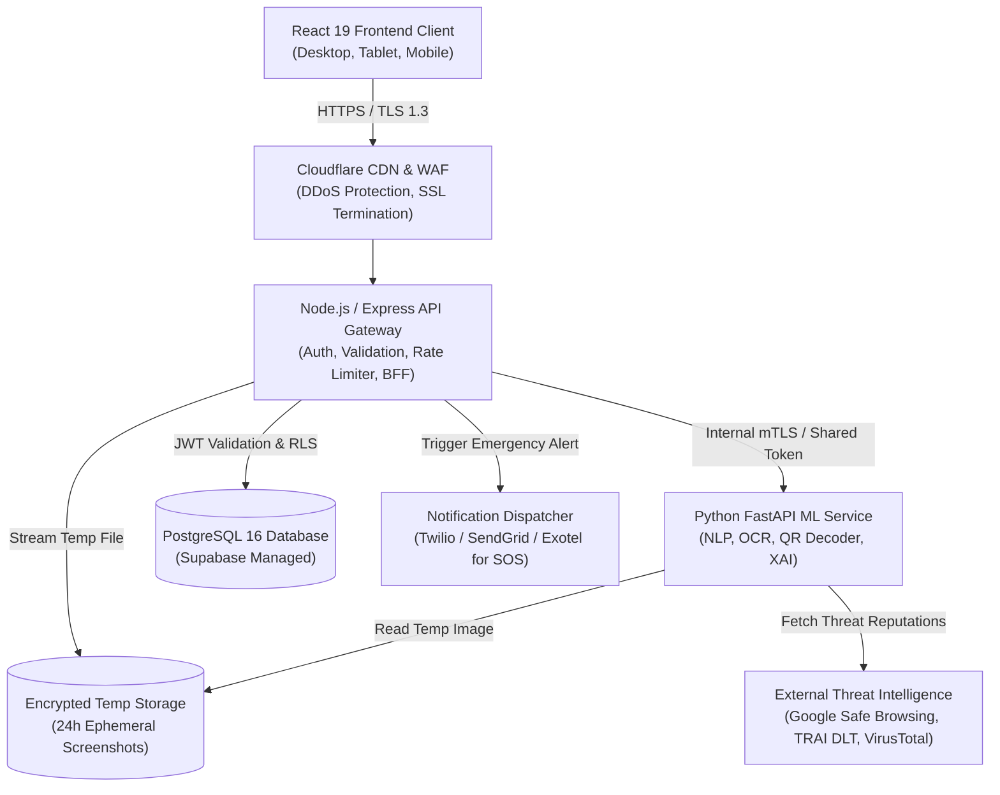
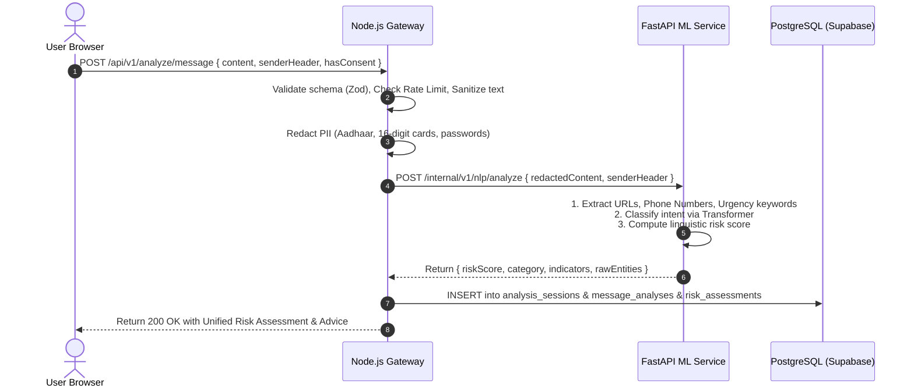
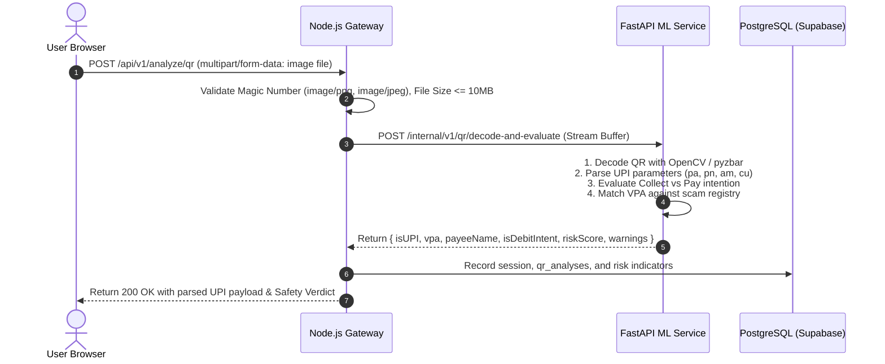
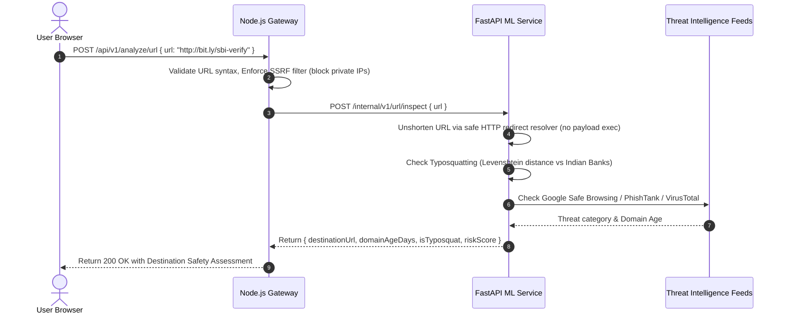
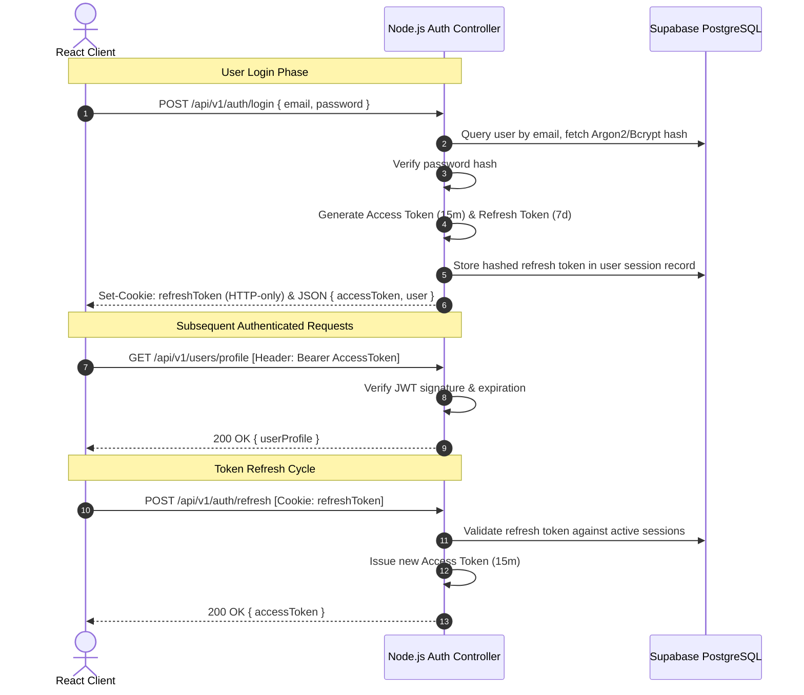

# System Architecture Document
## Project: FraudShield — AI-Powered Digital Payment Fraud Prevention Platform
**Document Version:** 1.0.0  
**Status:** Approved for Implementation Phase  
**Architecture Classification:** Distributed Micro-Services & Asynchronous Analytics  

---

## 1. System Overview & Technology Stack

FraudShield is structured as a decoupled, multi-tier system composed of a modern client application, a resilient Node.js API Gateway / Backend-For-Frontend (BFF), an isolated Python FastAPI Machine Learning & Computer Vision microservice, and a cloud-native PostgreSQL database managed via Supabase.

```
+----------------------------------------------------------------------------------------------------+
|                                         PRESENTATION TIER                                          |
|  React 19 + Vite + Tailwind CSS v4 + React Router DOM + React Hook Form + Zod + Lucide + Recharts  |
+----------------------------------------------------------------------------------------------------+
                                                  │ HTTPS / TLS 1.3
                                                  ▼
+----------------------------------------------------------------------------------------------------+
|                                    BACKEND-FOR-FRONTEND (BFF)                                      |
|            Node.js (LTS) + Express.js + REST APIs + JWT Auth + Rate Limiting + Multer              |
+----------------------------------------------------------------------------------------------------+
                         │                                                   │
      Internal mTLS REST │                                                   │ PostgreSQL Wire / Pool
                         ▼                                                   ▼
+---------------------------------------------+     +------------------------------------------------+
|          AI/ML DETECTION ENGINE             |     |           DATA STORAGE & IDENTITY              |
|  Python 3.11 + FastAPI + Uvicorn            |     |  PostgreSQL 16 (Supabase)                      |
|  - NLP: Transformer / Heuristics            |     |  - Normalized Relational Tables                |
|  - OCR: EasyOCR / Tesseract                 |     |  - Row Level Security (RLS)                    |
|  - QR: OpenCV / pyzbar                      |     |  - PostGIS / PgBouncer Connection Pooling      |
|  - Explainability: Weighted Attribution     |     |  - Supabase Storage (Encrypted Temporary S3)   |
+---------------------------------------------+     +------------------------------------------------+
```

### 1.1 Technology Stack Details

| Domain | Technology / Library | Version | Architectural Responsibility |
|---|---|---|---|
| **Frontend Framework** | React | 19.x | Modern UI rendering with Concurrent features, Suspense, and Transitions |
| **Build Tooling** | Vite | 5.x / 6.x | Fast HMR, optimized tree-shaking and ES module production bundling |
| **Language** | JavaScript (ESNext) | ES2023+ | Clean, modular component and business logic authoring |
| **Styling** | Tailwind CSS | v4.x | High-performance CSS-first utility design system with native CSS variables |
| **Client Routing** | React Router DOM | v6.x / v7.x | Declarative client-side routing, protected routes, and breadcrumbs |
| **HTTP Client** | Axios | 1.7+ | Configurable client with request/response interceptors for JWT injection |
| **Form Management** | React Hook Form | 7.x | Uncontrolled form inputs with minimal re-renders for performant data entry |
| **Schema Validation** | Zod | 3.23+ | Client-side input validation paired with form schemas and API contracts |
| **Iconography** | Lucide React | Latest | Clean, accessible vector icons for clear security visual cues |
| **Data Visualization** | Recharts | 2.12+ | Interactive risk score gauge, threat radar charts, and timeline metrics |
| **Backend Framework** | Node.js / Express.js | Node 20 LTS / Express 4.19+ | API routing, auth verification, validation, file ingress, rate limiting |
| **Auth & Tokens** | JSON Web Tokens (jsonwebtoken) | 9.x | Stateless access tokens (15m) + secure HTTP-only refresh tokens (7d) |
| **Database** | PostgreSQL | 16.x (via Supabase) | ACID relational data persistence, indexing, foreign keys, and RLS |
| **AI / ML Runtime** | Python / FastAPI | Python 3.11 / FastAPI 0.111+ | Asynchronous REST endpoints for heavy compute NLP, OCR, and QR decoding |
| **Computer Vision / OCR**| EasyOCR / OpenCV / pyzbar | Latest stable | Text extraction from payment screenshots and QR code image decoding |
| **NLP & Classifiers** | Hugging Face Transformers / scikit-learn | Latest | Phishing intent classification, urgency scoring, entity extraction |

---

## 2. High-Level System Architecture



---

## 3. Component Architecture & Microservice Decomposition

### 3.1 Backend-for-Frontend (Node.js & Express)
The Node.js server acts as the central gatekeeper and orchestrator:
1. **Security Perimeter:** Terminates incoming client requests, verifies JWT signatures, enforces CORS policies, sets Helmet security headers, and applies IP and user-based rate limiting.
2. **Input Sanitization & Ingress:** Validates incoming payloads via Zod/Joi schemas. Intercepts file uploads via `multer` into memory buffers or ephemeral storage with strict magic-number validation.
3. **Service Orchestration:** Dispatches raw text, image streams, or URLs to the Python AI service. Blends ML inference results with business rules (e.g., trusted contact triggers, user history lookup).
4. **Data Persistence:** Writes analysis sessions, incident records, and consent logs to Supabase PostgreSQL using connection pooling (PgBouncer).
5. **Notification Dispatcher:** Dispatches SMS/Email alerts to Trusted Contacts when critical threat thresholds are breached.

### 3.2 AI & Computer Vision Service (Python & FastAPI)
An isolated microservice specialized for compute-heavy heuristics:
1. **NLP Processing Engine:**
   - Heuristic Lexicon Parser: Scans for urgency tokens, high-risk financial verbs ("block", "debit", "electricity cut", "KYC expired", "digital arrest").
   - Semantic Classifier: Lightweight transformer (DistilBERT fine-tuned on Indian cyber fraud corpus) categorizing the threat vector.
2. **Computer Vision & OCR Engine:**
   - Image Pre-processing: Grayscale conversion, Otsu thresholding, skew correction, and noise reduction via OpenCV.
   - OCR Extraction: EasyOCR / Tesseract engine extracting text fields, timestamps, UTR numbers, and bank logos.
   - Forgery Heuristic Detector: Detects mismatched font glyphs, irregular line alignments, and non-compliant transaction IDs typical of fake payment proof apps.
3. **QR & UPI Parser:**
   - QR Detection: Decodes 1D/2D barcodes using `pyzbar` and `wechat_qrcode`.
   - UPI Protocol Dissector: Validates URI syntax (`upi://pay`), extracts merchant category codes (MCC), transaction notes, and warns if `am` (amount) or `tr` is bound to a debit collect intent.
4. **Explainable AI (XAI) Synthesizer:**
   - Translates model feature weights into human-readable indicators.
   - Generates the composite 0–100 Risk Score with weighted factor contributions.

---

## 4. Service Communication & Protocols

| Channel | Protocols | Authentication / Security | Data Format |
|---|---|---|---|
| **Client <-> Node.js Gateway** | HTTPS (TLS 1.3) / WebSocket (optional alerts) | Bearer JWT (Access Token) + Secure HTTP-only Cookie | JSON / `multipart/form-data` |
| **Node.js Gateway <-> FastAPI Service** | HTTP/2 (Private VPC) / mTLS | Pre-shared Secret Token / Service-to-Service Header | JSON / Streamed Buffers |
| **Node.js Gateway <-> Supabase PostgreSQL** | PostgreSQL Wire Protocol / Pooler | TLS 1.3 + Supabase Service Role Key / User JWT | SQL / Relational Tuples |
| **Node.js <-> Notification Providers** | HTTPS REST | Provider API Key (Environment Secret) | JSON |

---

## 5. End-to-End Data Flow Diagrams

### 5.1 Message & SMS Analysis Data Flow


### 5.2 QR Code & UPI Analysis Data Flow


### 5.3 URL Analysis & Safety Check Flow


---

## 6. Authentication & Authorization Flow

FraudShield uses a robust, double-token authentication architecture:
1. **Access Token:** Short-lived JWT (15-minute expiration) carried in the `Authorization: Bearer <token>` header for stateless API verification.
2. **Refresh Token:** Long-lived cryptographically signed token (7-day expiration) stored exclusively in an **HTTP-only, Secure, SameSite=Strict** cookie, preventing XSS access.
3. **Session Invalidation:** Database tracks `refresh_token_id` in the `users` table to permit global sign-out and revocation across devices.



---

## 7. Error Handling & Resilience Strategy

### 7.1 Unified Error Response Envelope
All API error responses adhere to a consistent contract across all services:
```json
{
  "success": false,
  "error": {
    "code": "VALIDATION_FAILED",
    "message": "The provided input could not be validated.",
    "details": [
      {
        "field": "url",
        "issue": "Invalid URL format or private IP address detected."
      }
    ],
    "timestamp": "2026-11-15T08:30:00.000Z",
    "requestId": "req_8f1b2c3d4e5f"
  }
}
```

### 7.2 Error Taxonomy & HTTP Status Codes
| HTTP Status | Error Code | Description & Client Action |
|---|---|---|
| **400 Bad Request** | `BAD_REQUEST` / `VALIDATION_FAILED` | Malformed JSON or Zod schema violation. Displays inline field errors. |
| **401 Unauthorized** | `TOKEN_EXPIRED` / `INVALID_CREDENTIALS` | Triggers client silent refresh or redirects to `/login`. |
| **403 Forbidden** | `FORBIDDEN_RESOURCE` | Authenticated user lacks permission for target resource. |
| **413 Payload Too Large** | `FILE_SIZE_EXCEEDED` | File upload exceeds 10 MB limit. Prompts user to compress image. |
| **422 Unprocessable** | `UNSUPPORTED_MEDIA` / `CORRUPT_QR` | Image contains no recognizable QR code or text. Prompts clearer re-scan. |
| **429 Too Many Requests** | `RATE_LIMIT_EXCEEDED` | User or IP exceeded scan budget. Displays cooldown timer. |
| **502 / 503 Gateway Error**| `AI_SERVICE_UNAVAILABLE` | Python ML service degraded. Triggers Node.js fallback heuristic engine. |
| **500 Internal Error** | `INTERNAL_SERVER_ERROR` | Unhandled exception. Logged to Sentry/Winston with sanitized error id. |

### 7.3 Graceful Degradation (Fallback Architecture)
If the Python FastAPI ML microservice becomes unresponsive:
1. The Node.js gateway catches the connection timeout (configured at 3,000 ms).
2. It executes a local **Rule-Based Deterministic Fallback Engine** written in JavaScript:
   - Scans text for high-risk regex patterns (e.g., standard Indian electricity disconnections, lottery keywords).
   - Validates VPA structure and known bad handles via local memory cache.
   - Flags unshortened URLs using a cached malicious domain blocklist.
3. The response is returned to the user with a degraded warning:  
   `"riskAssessment": { "score": 65, "mode": "FALLBACK_HEURISTIC", "notice": "Fast heuristic mode activated due to high network load." }`

---

## 8. Comprehensive Security & Privacy Architecture

### 8.1 Authentication & Authorization Security
- **Argon2id Password Hashing:** 64 MB memory cost, 3 iterations, 4 parallelism threads.
- **Role-Based Access Control (RBAC):** Roles (`USER`, `VERIFIED_USER`, `ADMIN`). Sensitive endpoints enforce authorization decorators.
- **Account Lockout:** 5 consecutive failed login attempts trigger a 15-minute cooldown.

### 8.2 Data Encryption Standards
- **In-Transit:** Mandatory HTTPS / TLS 1.3 with HSTS (`Strict-Transport-Security: max-age=63072000; includeSubDomains; preload`).
- **At-Rest:** Tables containing PII (names, phone numbers, contact lists) use PostgreSQL column-level encryption (`pgcrypto`) or Supabase Vault.
- **Ephemeral Storage:** Uploaded image files are held in RAM buffers or encrypted scratch storage (`AES-256-GCM`) with auto-deletion jobs running every 60 minutes.

### 8.3 Secure File Upload Pipeline
1. **Magic Number Inspection:** Verification of initial file bytes using `file-type` to verify true MIME types (`image/png`, `image/jpeg`, `image/webp`). Executable file extensions disguised as images are dropped immediately.
2. **Virus & Malware Scanning:** ClamAV stream scanner checks memory buffers for embedded steganographic payloads.
3. **EXIF Metadata Stripping:** All GPS coordinates, camera serial numbers, and device tags are sanitized via Sharp/Pillow before inspection.

### 8.4 Anti-SSRF (Server-Side Request Forgery) Architecture
During URL unshortening and domain analysis, the backend acts as a proxy. To prevent attackers from using FraudShield to probe cloud internal services:
- **Private IP Blacklist:** Resolve DNS addresses and drop any address resolving to:
  - `0.0.0.0/8`, `10.0.0.0/8`, `100.64.0.0/10`, `127.0.0.0/8`, `169.254.0.0/16` (Cloud metadata), `172.16.0.0/12`, `192.168.0.0/16`, `::1/128`, `fc00::/7`.
- **Protocol Restriction:** Only `http:` and `https:` schemes allowed. `file://`, `gopher://`, `ftp://` rejected.
- **Hop Limitation:** Safe redirect follower terminates after a maximum of 5 hops to prevent recursive redirect denial-of-service.

### 8.5 Rate Limiting & Abuse Prevention
- **IP-Based Token Bucket:** 60 requests per minute for general API browsing.
- **Analysis Budget:** 15 scans per minute per authenticated user (5 scans per minute for unauthenticated guest sessions).
- **CORS Policy:** Strict whitelist allowing only the official FraudShield client origins.

### 8.6 Privacy, Consent & DPDP Act 2023 Compliance
- **Explicit Processing Consent:** Users must acknowledge consent before analyzing personal messages or screenshots.
- **Automated PII Masking:** Regex and Named Entity Recognition (NER) replace phone numbers, PAN cards, Aadhaar IDs, and 16-digit card numbers with `[REDACTED]` prior to persistent storage.
- **Right to Erasure (Data Forget):** One-click button in User Settings invokes a cascade deletion of all user sessions, analyses, and contact associations.

---

## 9. Complete Repository Folder Structure

```
FraudShield/
├── .github/
│   └── workflows/
│       ├── frontend-ci.yml
│       ├── backend-ci.yml
│       └── ai-service-ci.yml
├── docs/
│   ├── PRD.md
│   ├── SYSTEM_ARCHITECTURE.md
│   ├── DATABASE_SCHEMA.md
│   ├── API_SPECIFICATION.md
│   ├── UI_UX_GUIDELINES.md
│   └── DEVELOPMENT_ROADMAP.md
├── client/                                 # Frontend (React 19 + Vite)
│   ├── public/
│   │   ├── favicon.svg
│   │   └── robots.txt
│   ├── src/
│   │   ├── assets/                         # SVG icons, illustrations, badges
│   │   ├── components/                     # Reusable UI component library
│   │   │   ├── common/
│   │   │   │   ├── Button.jsx
│   │   │   │   ├── Card.jsx
│   │   │   │   ├── Input.jsx
│   │   │   │   ├── Modal.jsx
│   │   │   │   └── Badge.jsx
│   │   │   ├── analysis/
│   │   │   │   ├── RiskGauge.jsx          # Recharts radial meter
│   │   │   │   ├── ThreatIndicatorCard.jsx
│   │   │   │   ├── FactorBreakdown.jsx
│   │   │   │   └── RecommendationBox.jsx
│   │   │   ├── layout/
│   │   │   │   ├── Navbar.jsx
│   │   │   │   ├── Footer.jsx
│   │   │   │   ├── Sidebar.jsx
│   │   │   │   └── PageContainer.jsx
│   │   │   └── feedback/
│   │   │       ├── AlertBanner.jsx
│   │   │       ├── SeniorToggle.jsx       # High contrast / Large text switcher
│   │   │       └── LoadingSkeleton.jsx
│   │   ├── context/
│   │   │   ├── AuthContext.jsx
│   │   │   └── ThemeContext.jsx
│   │   ├── hooks/
│   │   │   ├── useAuth.js
│   │   │   ├── useAnalysis.js
│   │   │   └── useDebounce.js
│   │   ├── pages/                          # 13 Application Pages
│   │   │   ├── LandingPage.jsx
│   │   │   ├── ProtectionDashboard.jsx
│   │   │   ├── MessageAnalyzer.jsx
│   │   │   ├── QrAnalyzer.jsx
│   │   │   ├── UrlChecker.jsx
│   │   │   ├── UnifiedResults.jsx
│   │   │   ├── FraudResponseCenter.jsx
│   │   │   ├── FraudAwareness.jsx
│   │   │   ├── LoginPage.jsx
│   │   │   ├── RegisterPage.jsx
│   │   │   ├── ProfileSettings.jsx
│   │   │   ├── PrivacyPolicy.jsx
│   │   │   └── TermsConditions.jsx
│   │   ├── routes/
│   │   │   ├── AppRoutes.jsx
│   │   │   └── ProtectedRoute.jsx
│   │   ├── services/                       # API integration modules
│   │   │   ├── api.js                      # Axios instance with interceptors
│   │   │   ├── authService.js
│   │   │   ├── analysisService.js
│   │   │   ├── contactService.js
│   │   │   └── incidentService.js
│   │   ├── utils/
│   │   │   ├── formatters.js
│   │   │   ├── validators.js               # Zod client schemas
│   │   │   └── constants.js
│   │   ├── index.css                       # Tailwind CSS v4 directives
│   │   ├── main.jsx
│   │   └── App.jsx
│   ├── index.html
│   ├── package.json
│   ├── tailwind.config.js
│   └── vite.config.js
│
├── server/                                 # Backend API Gateway (Node.js & Express)
│   ├── src/
│   │   ├── config/
│   │   │   ├── db.js                       # Supabase client pool configuration
│   │   │   ├── env.js                      # Environment variable schema validation
│   │   │   └── security.js                 # CORS, Helmet, Rate limiter configs
│   │   ├── constants/
│   │   │   ├── errorCodes.js
│   │   │   └── threatLevels.js
│   │   ├── controllers/
│   │   │   ├── authController.js
│   │   │   ├── messageAnalysisController.js
│   │   │   ├── qrAnalysisController.js
│   │   │   ├── urlAnalysisController.js
│   │   │   ├── assessmentController.js
│   │   │   ├── userController.js
│   │   │   ├── contactController.js
│   │   │   └── incidentController.js
│   │   ├── middlewares/
│   │   │   ├── authenticate.js             # JWT extraction & verification
│   │   │   ├── validateRequest.js          # Zod schema validation middleware
│   │   │   ├── rateLimiter.js
│   │   │   ├── uploadMiddleware.js         # Multer config with file-type checks
│   │   │   ├── ssrfGuard.js                # DNS resolver private IP blocker
│   │   │   └── errorHandler.js             # Global centralized error handler
│   │   ├── models/                         # Database queries / Data Access Objects
│   │   │   ├── userModel.js
│   │   │   ├── analysisModel.js
│   │   │   ├── contactModel.js
│   │   │   └── incidentModel.js
│   │   ├── routes/
│   │   │   ├── authRoutes.js
│   │   │   ├── analyzeRoutes.js
│   │   │   ├── assessmentRoutes.js
│   │   │   ├── userRoutes.js
│   │   │   ├── contactRoutes.js
│   │   │   ├── incidentRoutes.js
│   │   │   └── index.js
│   │   ├── services/
│   │   │   ├── aiServiceClient.js          # HTTP client to Python FastAPI
│   │   │   ├── notificationService.js      # SMS/Email dispatcher
│   │   │   ├── piiRedactor.js              # Regex & entity masking
│   │   │   └── fallbackRuleEngine.js       # Local heuristic fallback
│   │   ├── utils/
│   │   │   ├── logger.js                   # Structured logging (Winston)
│   │   │   └── tokenUtils.js               # JWT signing & verification
│   │   └── app.js                          # Express app entry point
│   ├── server.js                           # HTTP listener & lifecycle management
│   ├── package.json
│   └── .env.example
│
├── ai_service/                             # AI & Computer Vision Service (Python FastAPI)
│   ├── app/
│   │   ├── api/
│   │   │   ├── v1/
│   │   │   │   ├── endpoints/
│   │   │   │   │   ├── nlp_analysis.py
│   │   │   │   │   ├── qr_analysis.py
│   │   │   │   │   ├── ocr_analysis.py
│   │   │   │   │   └── url_inspection.py
│   │   │   │   └── api_router.py
│   │   ├── core/
│   │   │   ├── config.py                   # Pydantic Settings
│   │   │   └── security.py                 # Internal auth token validation
│   │   ├── models/
│   │   │   ├── schemas.py                  # Pydantic request/response schemas
│   │   │   └── weights.py                  # Scoring matrices & thresholds
│   │   ├── services/
│   │   │   ├── nlp_engine.py               # Threat classification & urgency scorer
│   │   │   ├── ocr_engine.py               # Screenshot text extraction & forgery check
│   │   │   ├── qr_engine.py                # UPI URI parser & VPA reputation check
│   │   │   ├── url_inspector.py            # Unshortener & typosquatting calculator
│   │   │   └── xai_engine.py               # Explainable AI summary synthesizer
│   │   ├── utils/
│   │   │   ├── image_processing.py         # OpenCV image normalization
│   │   │   └── bank_regex.py               # Official Indian bank patterns
│   │   └── main.py                         # FastAPI application bootstrap
│   ├── tests/
│   ├── requirements.txt
│   ├── Dockerfile
│   └── .env.example
│
├── database/                               # Migrations & Schema DDL
│   ├── migrations/
│   │   ├── 001_initial_schema.sql
│   │   ├── 002_indexes_and_constraints.sql
│   │   └── 003_rls_policies.sql
│   └── seeds/
│       └── 001_seed_threat_sources.sql
│
├── .gitignore
├── docker-compose.yml                      # Full local stack orchestration
└── README.md
```

---

## 10. Summary & Architectural Validation

This architecture provides an enterprise-ready, defense-in-depth foundation for FraudShield. It decouples high-concurrency client requests from compute-intensive ML workloads, enforces strict security boundaries (anti-SSRF, zero persistent PII, dual-token authentication), and guarantees high availability through automated fallback heuristics.
